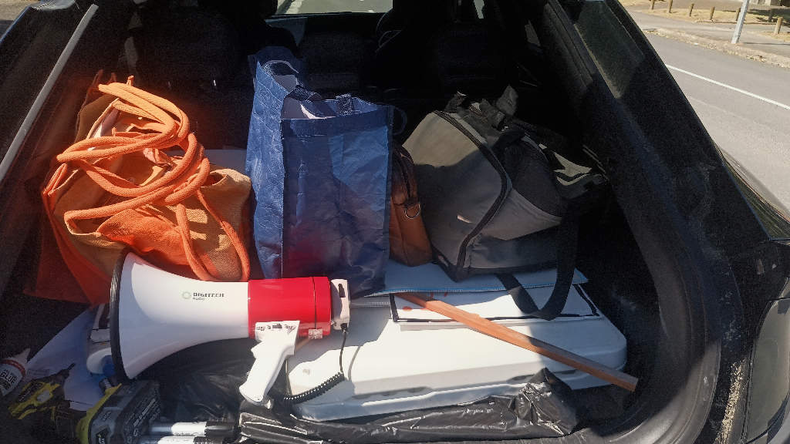
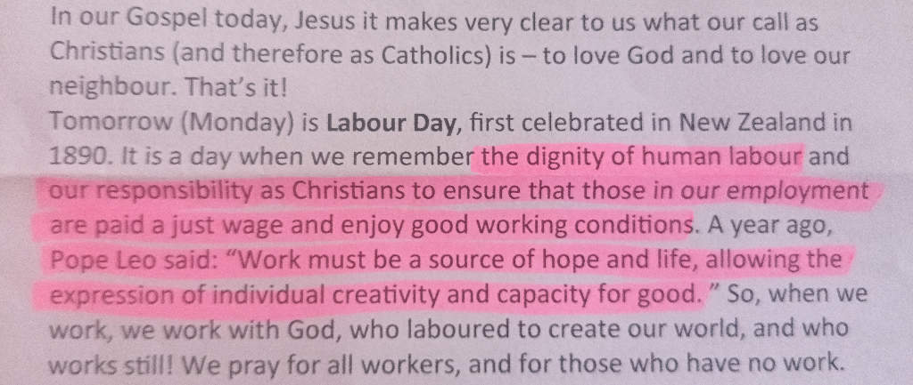
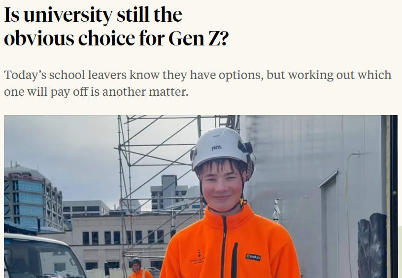

## Feelings come together over Labour Weekends

Labour Day is a big one for me, not for the long weekend and a hopeful summer teaser, but for reflecting on the ordinary worker, and the ongoing struggle to hold onto the ["8 hours that we work here, 8 hours for to sleep, 8 hours with the family and the company you keep"](https://wellingtonseashantysociety.bandcamp.com/track/we-re-not-in-london-now-sam-parnell-s-law).

And last week was a big one. 

### That thing where you're compelled to embarrass your employer; awkward

I had to lead our union members at EIT on a walkout strike on Wednesday.

We were compelled to strike because in the nearly 6 months since bargaining for a new agreement began, EIT has yet to provide responses to our claims or put forward any of their own. Union branches at several other polytechnics did not strike last week and did not [generate news stories embarrassing their employers](https://www.nzherald.co.nz/gisborne-herald/news/tertiary-education-union-strike-eit-tairawhiti-members-join-nationwide-walkout/GEGAPD2CMNCVJKUMS3E73WCJNM/). Simply because they're making some progress at the table.

It sucks, because I care about EIT's role in the future of Tairāwhiti. But as an elected leader, I will do everything I can to have our message heard. 

### Actual Christian values

The plight of the ordinary worker, your neighbour, is central to Catholic teaching. Something highlighted in services over Labour Weekend.

It does make me wonder about voting behaviour during elections! I think of Catholic voters going to reconciliation after voting: 

> Forgive me father for I have been swayed by reactionaries and self-interest.

Because from our Labour Weekend newsletter... 

> Labour Day is a day that we remember "the dignity of human labour" and "our responsibility as Christians to ensure that those in our employment are paid a just wage and enjoy good working conditions". 

Pope Leo has come out strong on worker rights on multiple fronts, including AI. And has said: 

> "Work must be a source of hope and life, allowing the expression of individual creativity and capacity for good". 

Listeing to the sermon on Sunday, it was said that teachers were often asked to reduce the commandments down to a single thing, or the 600+ rules of the pharisees down to one rule. And Jesus (without doubt an activist social democrat of his era) said simply to love God with all your heart. But how do you love an invisible concept with all your heart? Jesus said you demonstrate that by loving your neighbour.

I sat there thinking of EIT leadership high up there, and **me having led a strike for the workers alongside me, as a demonstration of loving my neighbour**. 

Still, I would rather be doing everything I can to develop and promote EIT as our region's best future-focused skills provider. As a special place focused on the ordinary worker.

### Strong public vocational education 

Strong public vocational education is going to be central to future-focused regional development. 

Gen-Z school leavers are telling us loud and clear, thinking aloud about ["student debt, the difficulty of finding work and the rise of AI"](https://www.rnz.co.nz/life/lifestyle/is-university-still-the-obvious-choice-for-gen-z). And landing on trades. A pathway that offers "the chance to earn while gaining qualifications". Students can see what is happening out there for music, for creative arts, "that AI is starting to take jobs that normally graphic designers might have taken or music production would have".

Parties across the political spectrum are listening and recognising the need to elevate the status and funding of polytechnics.

From **Opportunity** wanting to 

> turn polytechnics into regional innovation hubs with a mandate to lead regional productivity growth

And 

> restore the $80 million in polytechnic baseline funding cut by the current Government

To **ACT** aiming to

> put vocational education on an equal footing with universities by building a national trades pathway in secondary schools

The **Greens** 

> would expand free apprenticeship programmes, abolish the training wage so apprentices are paid properly while they learn, and introduce a $2000 equipment grant to cover apprentices’ tools, uniforms, and course materials

And

> would offer every 16- to 24-year-old who has been out of work for six months a pathway into a job in their local community

While Labour will

> guarantee a job of at least 0.8 FTE to every eligible New Zealand-trained graduate nurse, about 2,400 a year

So it is a cause worth advocating strongly for, to hold these parties to their promises and to **support our polytechnics in their plea for more funding**.

### Advocating from the bottom up 

As a union representative, I find most of the time I'm doing advocacy work in support of my employer: protesting for increased public funding into the sector, and upholding employment agreements and policies that keep HR out of trouble. 

And so...

#### My speech at our strike protest

For a lot of the time, it’s like we, the union, are allies of our institutions.  

We are out there – out here – publicly fighting for strong properly funded public vocational education.

Funding that’s not about surviving but thriving.

Funding that means our trades aren’t over-enrolled, unfunded, and our tutors burning out.

Funding that means our Nursing schools can attract nursing professionals out of the health sector to teach our future nurses.

(Jeez, you know our pay and conditions have gotten bad when we can’t attract people out of our broken health system.)

Funding that means if you’re a young person and want to learn how to build houses or fix cars, you can.

Funding that can invest in local capability development and future-focused local skills growth without prioritising the international student dollar.

Local vocational education is a public good, not a bloody discount marketplace.

===

So yeah, we’re out here advocating in service of our employers.

Just like we do when we ensure their agreements are upheld, when we ensure their employee’s workloads are fair and their career advancement is supported.  

We’re an HR function!

They should be out here with us!

===

Instead, every few years they decide not to negotiate with us in good faith over a new collective agreement.

All we really want is the same fair working conditions across the country, not winners and losers.

And pay that keeps up with the cost of living so we can focus on our awesome students in front of us – our next nurses, mechanics, IT experts, builders, growers, chefs, farmers, social workers, teachers, makers and creators – the essential workers!

===

So come on EIT, come out here and join us in the fight against austerity in education for the public good.  

Come and join us at the table in the fight for fair! 

